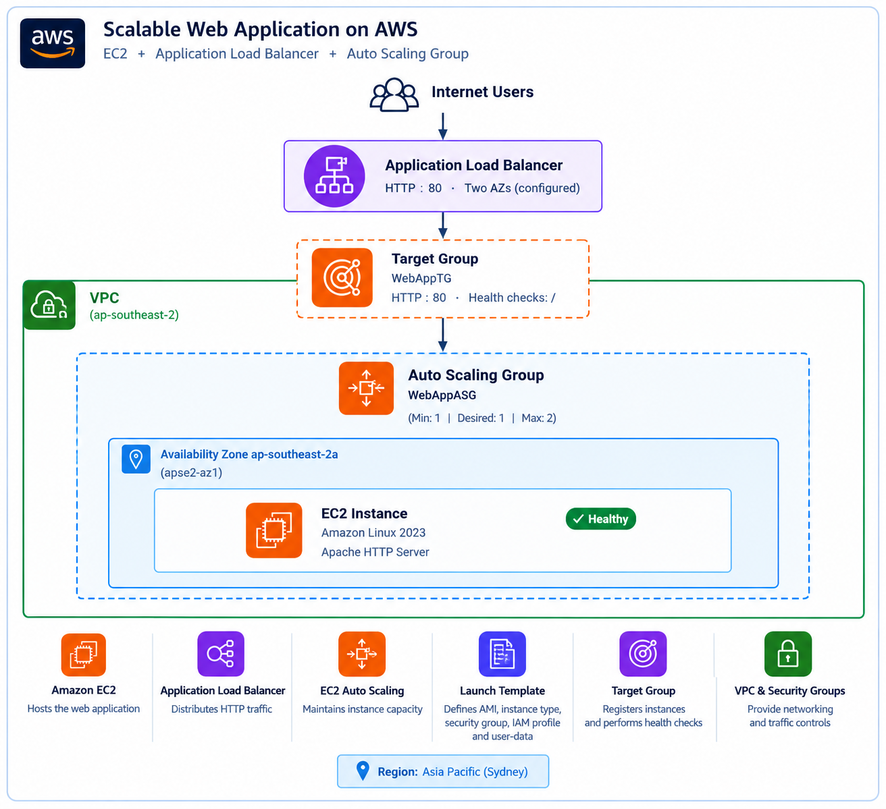

# Scalable Web Application on AWS

A highly available web application deployment using Amazon EC2,
an Application Load Balancer, and an EC2 Auto Scaling Group.

## Project Overview

This project demonstrates how to deploy and serve a static web
application using AWS infrastructure. Apache HTTP Server runs on
Amazon Linux 2023 EC2 instances. An Application Load Balancer
routes incoming HTTP traffic to registered instances, while an
Auto Scaling Group manages instance capacity.

## Architecture

### AWS Services Used

- Amazon EC2 — hosts the web application.
- Application Load Balancer — distributes HTTP traffic.
- EC2 Auto Scaling — maintains the configured instance capacity.
- Launch Template — defines the AMI, instance type, security group,
  IAM instance profile, and user-data configuration.
- Target Group — registers instances and performs HTTP health checks.
- IAM / Systems Manager — enables managed instance access.
- Amazon VPC and Security Groups — provide networking and traffic controls.

## Application

The website displays a welcome page confirming that the application
is served through Apache HTTP Server.

## Deployment Steps

1. Use an AWS VPC with suitable subnets and internet routing.
2. Create an EC2 security group that allows HTTP traffic from the
   Application Load Balancer security group.
3. Create an internet-facing Application Load Balancer with an HTTP
   listener on port 80.
4. Create a target group using HTTP port 80 and health-check path `/`.
5. Create a launch template using Amazon Linux 2023 and the
   `scripts/user-data.sh` bootstrap script.
6. Configure an Auto Scaling Group to use the launch template and
   register instances with the target group.
7. Access the application through the ALB DNS name.

## Validation

- Verified the application responds with HTTP 200 OK locally.
- Verified the target group reported a Healthy EC2 target.
- Verified the website was accessible through the ALB DNS name.
- Confirmed that the user-data configuration installs and starts Apache.

## Repository Structure

- `app/` — website HTML.
- `scripts/` — EC2 user-data bootstrap script.
- `architecture/` — architecture diagram.
- `screenshots/` — deployment and validation evidence.

## Security Notes

- Do not commit AWS access keys, passwords, private keys, or account-specific secrets.
- Restrict administrative access and follow least-privilege IAM practices.
- Keep backend HTTP access limited to the ALB security group.
- Review AWS costs and delete resources when the project is no longer needed.

## Cleanup

When finished, remove the resources you no longer need, including the
Auto Scaling Group, load balancer, target group, and launch template,
after checking dependencies and confirming that nothing else relies on them.
